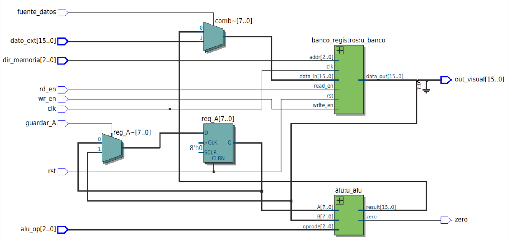
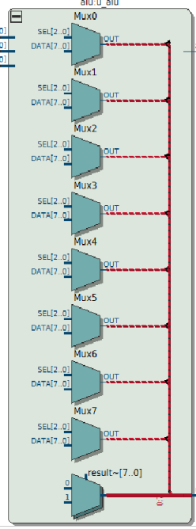
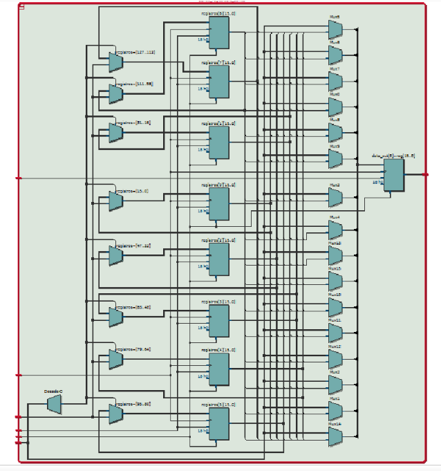
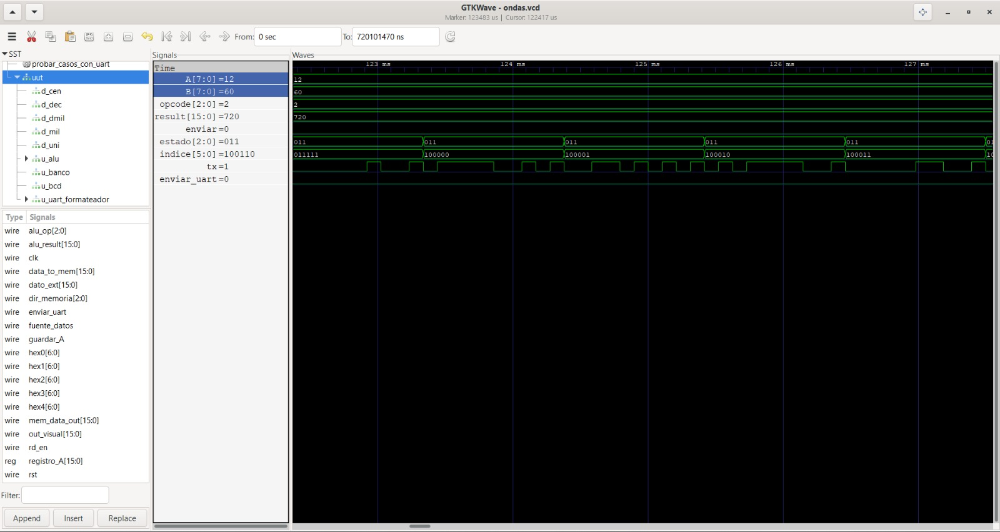
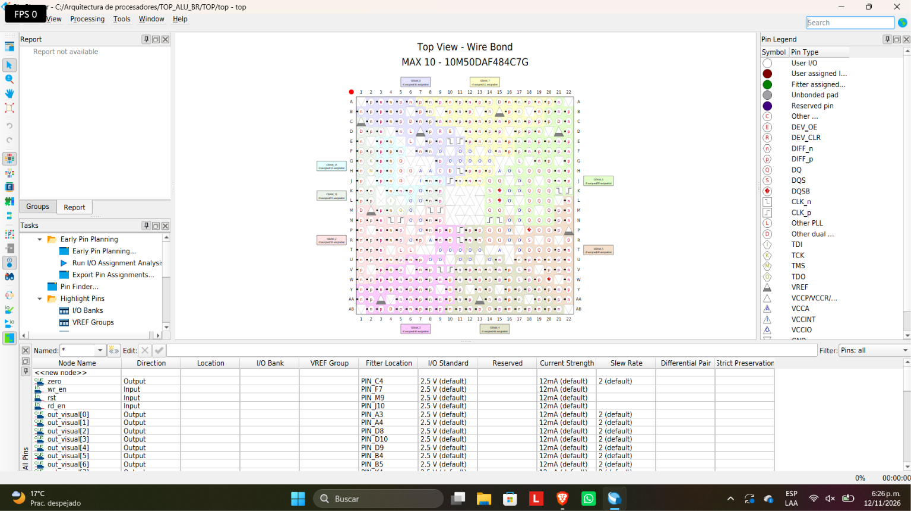
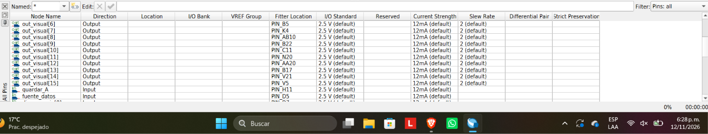
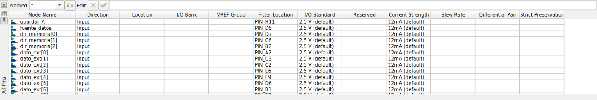
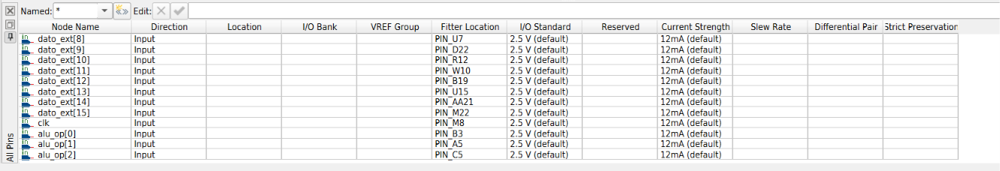

# Lab04 - ALU, banco de registros y UART

# Integrantes
* [Daniel Penagos Castro](https://github.com/Daniel-Penagos)
* [Danilo Forero Rodriguez](https://github.com/jouseddanilo)
* [Brayan Extidt Torres Gaona](https://github.com/BrayanExtidt)

# Informe

Indice:

1. [Documentación del diseño implementado](#documentación-del-diseño-implementado)
2. [Simulaciones](#simulaciones)
3. [Evidencias de implementación](#evidencias-de-implementación)
4. [Preguntas](#preguntas)
5. [Observaciones y mejoras](#observaciones-y-mejoras)
6. [Conclusiones](#conclusiones)
7. [Referencias](#referencias)


---

## Documentación del diseño implementado

### 1. Descripción general

El sistema es un pequeño datapath de procesador de 8 bits compuesto por:

* Una **ALU** de 8 operaciones, construida de forma estructural a partir de sumadores completos.
* Un **banco de registros** de 8 posiciones para almacenar operandos y resultados.
* Un módulo **top** que conecta la memoria con la ALU y decide qué dato se guarda.
* Un **transmisor UART** y un módulo `uart_datos` que arma un mensaje de texto con los operandos, el opcode, el resultado y las banderas, para visualizarlo en la terminal del PC.

Jerarquía de módulos:

```
top
├── banco_registros
├── alu
│   ├── sumador_restador8 (x2: suma y resta)
│   │   └── sumador8 → sumador4 → Sumador
│   ├── multiplicador8 → sumador8
│   ├── comparador8 → sumador_restador8
│   ├── corrimiento8
│   └── logica8
└── uart_datos
    └── uart
```
<br>
*Figura 1: Diagrama de bloques del sistema completo. 

---

### 2. Módulos aritméticos

#### 2.1 `Sumador` (sumador completo de 1 bit)

Suma tres bits (`A`, `B`, `Ci`) y entrega la suma `S` y el acarreo `Co`.

| Línea | Explicación |
|---|---|
| `assign S = Ci^(A^B);` | La suma es 1 cuando entran un número impar de unos. |
| `assign Co = Ci&(A^B)\|A&B;` | Hay acarreo si ambos bits valen 1, o si solo uno vale 1 y además entra acarreo. |

| A | B | Ci | S | Co |
|---|---|----|---|----|
| 0 | 0 | 0 | 0 | 0 |
| 0 | 1 | 0 | 1 | 0 |
| 1 | 1 | 0 | 0 | 1 |
| 1 | 0 | 1 | 0 | 1 |
| 1 | 1 | 1 | 1 | 1 |

#### 2.2 `sumador4` (sumador de 4 bits)

Conecta 4 instancias de `Sumador` en cascada (*ripple carry*). Los cables `c1`, `c2` y `c3` llevan el acarreo de cada bit al siguiente; el último acarreo sale por `Co`.

Ejemplo: `0111 + 0001 = 1000` (7 + 1 = 8).

#### 2.3 `sumador8` (sumador de 8 bits)

Usa dos `sumador4`: `mitad_baja` suma los bits [3:0] con el `Ci` externo, y `mitad_alta` suma los bits [7:4] recibiendo como acarreo de entrada `c_intermedio`.

#### 2.4 `sumador_restador8`

Suma o resta según `Ci` (`0` = suma, `1` = resta) y entrega el resultado como **magnitud** más una bandera de signo.

| Etapa | Descripción |
|---|---|
| 1. XOR de B | `cable_B_xor = Ci ^ B`. Con `Ci=0` B no cambia; con `Ci=1` B se invierte. |
| 2. Suma principal | `etapa1` calcula `A + (B^Ci) + Ci`. En resta equivale a `A + ~B + 1 = A - B` (complemento a 2). |
| 3. Signo | `signo = Ci & ~Co`. En una resta, si no hay acarreo de salida, A < B. |
| 4. Inversión | `cable_S_invertido = S_intermedio ^ es_negativo`. Si el resultado es negativo se invierten sus bits. |
| 5. Corrección | `etapa2` suma `+1` (por el `Ci = es_negativo`) para completar el complemento a 2 y obtener |A−B|. |

Ejemplos:

| Operación | Resultado `S` | `signo` |
|---|---|---|
| 5 + 3 | 8 | 0 |
| 5 − 3 | 2 | 0 |
| 3 − 5 | 2 | 1 |

#### 2.5 `multiplicador8`

Multiplica dos números de 8 bits sin signo, con resultado de 16 bits, mediante productos parciales:

1. **Productos parciales:** `PPi = {8{B[i]}} & A`. Si `B[i]=1` se copia `A`; si es 0 el producto parcial es cero.
2. **Alineación:** cada `PPi` se extiende a 16 bits y se desplaza `i` posiciones con ceros (`P1_ext = {7'b0, PP1, 1'b0}`, etc.).
3. **Suma en cascada:** 7 etapas (`S1` a `S6` y `M`), cada una con dos `sumador8` (mitad baja y alta), donde el acarreo de la baja entra a la alta.

```
P0 + P1 → S1
S1 + P2 → S2
...
S6 + P7 → M
```

Ejemplo: 255 × 3 = 765 (`0x02FD`).

#### 2.6 `comparador8`

Compara A con B reutilizando `sumador_restador8` con `Ci = 1` fijo (siempre resta A − B).

* `Igual`: NOR de todos los bits de la magnitud (todo ceros).
* `Menor = signo`.
* `Mayor = ~signo & ~Igual`.

| C[2] | C[1] | C[0] | Significado |
|---|---|---|---|
| 1 | 0 | 0 | A > B |
| 0 | 1 | 0 | A = B |
| 0 | 0 | 1 | A < B |

Los bits `C[7:3]` se fijan en 0.

---

### 3. Módulos lógicos

#### 3.1 `corrimiento8`

Desplaza `A` un bit a la derecha usando solo cableado: `S[i] = A[i+1]` y `S[7] = 0`. Equivale a dividir entre 2 (división entera). Ejemplo: `10110100` (180) → `01011010` (90).

#### 3.2 `logica8`

Calcula en paralelo tres operaciones bit a bit entre `A` y `B`: `res_or` (OR), `res_nand` (NAND) y `res_xor` (XOR).

Ejemplo con `A = 1100` y `B = 1010`: OR = `1110`, NAND = `0111`, XOR = `0110`.

---

### 4. ALU

La ALU instancia todos los módulos anteriores, que trabajan **simultáneamente** en hardware; un multiplexor (`case(opcode)`) selecciona cuál resultado llega a la salida `result` (16 bits).

| opcode | Operación | Fuente |
|---|---|---|
| `000` | Suma | `c_suma` |
| `001` | Resta (magnitud) | `c_resta` |
| `010` | Multiplicación | `c_mult` |
| `011` | Comparación | `c_comp` |
| `100` | Corrimiento a la derecha | `c_corr` |
| `101` | OR | `c_or` |
| `110` | NAND | `c_nand` |
| `111` | XOR | `c_xor` |

| Línea | Explicación |
|---|---|
| `wire [7:0] c_suma, ...` / `wire [15:0] c_mult;` | Cables que capturan la salida de cada módulo. |
| `sumador_restador8 u_sum (... .Ci(1'b0) ...)` | Instancia que siempre suma. |
| `sumador_restador8 u_res (... .Ci(1'b1) ...)` | La misma estructura, que siempre resta. |
| `always @(*) case(opcode)` | Multiplexor combinacional que elige el resultado. |
| `assign zero = ~(result[0] \| ... \| result[7]);` | Bandera de cero: NOR de los bits del resultado. |



---

### 5. Banco de registros

Memoria de 8 registros de 8 bits, con una dirección `addr` de 3 bits compartida para lectura y escritura.

| Señal | Función |
|---|---|
| `clk`, `rst` | Reloj y reset asíncrono (limpia registros y `data_out`). |
| `data_in` | Dato a escribir. |
| `addr` | Selecciona la casilla (0 a 7). |
| `write_en` | Si vale 1, guarda `data_in` en `registros[addr]` en el flanco de subida. |
| `read_en` | Si vale 1, copia `registros[addr]` a `data_out` en el flanco de subida. |
| `data_out` | Dato leído. |

Características importantes:

* La **escritura** es un decodificador (`case(addr)`), y la **lectura** es un multiplexor de 8 a 1.
* La **lectura es síncrona**: el dato aparece en `data_out` un ciclo de reloj después de activar `read_en`.
* Si no se activa `read_en`, `data_out` conserva su último valor.

<br>
*Figura 2: RTL Viewer del banco de registros. 
---

### 6. Módulo `top`

Conecta la memoria, la ALU y un registro auxiliar.

| Elemento | Función |
|---|---|
| `data_to_mem = fuente_datos ? dato_ext : alu_result` | Multiplexor de entrada a la memoria: dato externo (`1`) o resultado de la ALU (`0`). |
| `registro_A` | Registro temporal que atrapa la salida de la memoria cuando `guardar_A = 1`. Es necesario porque el banco tiene una sola salida de lectura. |
| `alu u_alu (.A(registro_A[7:0]), .B(mem_data_out[7:0]) ...)` | La ALU recibe A desde `registro_A` y B directamente desde la memoria. |
| `out_visual = mem_data_out` | Salida visible: el dato que se está leyendo de la memoria. |

Secuencia típica para operar (ejemplo 12 y 60):

| Paso | Señales | Efecto |
|---|---|---|
| 1 | `fuente_datos=1`, `dato_ext=12`, `dir=0`, `wr_en=1` | Guarda 12 en la dirección 0. |
| 2 | `dato_ext=60`, `dir=1`, `wr_en=1` | Guarda 60 en la dirección 1. |
| 3 | `wr_en=0`, `rd_en=1`, `dir=0` | Lee la dirección 0. |
| 4 | `guardar_A=1` | `registro_A = 12`. |
| 5 | `guardar_A=0`, `rd_en=1`, `dir=1` | La memoria entrega 60, que es B. |
| 6 | `alu_op=000` | La ALU calcula 72. |
| 7 | `fuente_datos=0`, `dir=2`, `wr_en=1` | Guarda el resultado en la dirección 2. |
| 8 | `wr_en=0`, `rd_en=1`, `dir=2` | `out_visual` muestra el resultado. |

> Como la lectura es síncrona, entre leer y guardar `registro_A` debe pasar un ciclo de reloj.
---

### 7. UART (transmisor)

Transmite un byte por la línea `tx` con formato **8N1**: 1 bit de inicio, 8 bits de datos (LSB primero), sin paridad y 1 bit de parada.

| Parámetro | Valor |
|---|---|
| `CLK_FREQ` | 50 000 000 Hz |
| `BAUD_RATE` | 9600 baudios |
| `BAUD_DIV` | 50 000 000 / 9600 = 5208 ciclos por bit |
| Duración por bit | ≈ 104 µs |
| Duración por byte (10 bits) | ≈ 1,04 ms |

Funcionamiento:

1. En reposo `tx = 1`, `busy = 0`.
2. Con un pulso en `start`, se arma la trama `{1'b1, data_in, 1'b0}`, `tx` baja a 0 (bit de inicio) y `busy = 1`.
3. `baud_count` cuenta hasta `BAUD_DIV - 1`; cada vez que lo alcanza, `bit_index` avanza y `tx` toma el siguiente bit de la trama.
4. Al terminar el bit de parada, `busy = 0` y `done` sube durante un ciclo.

Ejemplo: enviar `A` (`0x41`) produce la trama `1 01000001 0`; por `tx` sale: `0` (inicio), `1,0,0,0,0,0,1,0` (datos, LSB primero) y `1` (parada).


*Figura 3: Trama UART. `[COMPLETAR: insertar captura de simulación o analizador]`*

---

### 8. `uart_datos` (visualización de datos)

Módulo que arma un mensaje de texto de **42 caracteres** y lo envía carácter por carácter usando la `uart`. Formato:

```
A=XX B=XX OP=X RES=XXXX Z=X C=X OV=X N=X<CR><LF>
```

Ejemplo (A = `0x0C`, B = `0x3C`, suma): `A=0C B=3C OP=0 RES=0048 Z=0 C=0 OV=0 N=0`

Componentes:

* **Registros `_reg`:** al recibir `enviar` se copian los datos (A, B, opcode, resultado y banderas) para que el mensaje no cambie mientras se transmite.
* **`always @(*) case(indice)`:** tabla que convierte cada posición del mensaje en un carácter ASCII. Las banderas usan `bit ? "1" : "0"`, y los índices 40 y 41 son `0x0D` (retorno de carro) y `0x0A` (salto de línea).
* **`hex_ascii`:** convierte un nibble en su carácter hexadecimal: de 0 a 9 suma `0x30` y de 10 a 15 suma `0x41 - 10`.
* **FSM de 5 estados:**

| Estado | Acción |
|---|---|
| `ESPERAR` | `listo = 1`. Si llega `enviar` y la UART está libre, congela los datos, pone `indice = 0` y pasa a `PREPARAR`. |
| `PREPARAR` | Copia `caracter` a `dato_uart`. |
| `INICIAR` | Genera un pulso de un ciclo en `iniciar_uart` (el `start` de la UART). |
| `TRANSMITIR` | Espera a que la UART active `done`. |
| `SIGUIENTE` | Si `indice == 41` vuelve a `ESPERAR`; si no, incrementa `indice` y regresa a `PREPARAR`. |

Un mensaje completo tarda aproximadamente 42 × 1,04 ms ≈ 44 ms.

---

## Simulaciones

### 1. Descripción

Se creó un testbench que carga dos operandos en el banco de registros mediante `dato_ext`, los lee, atrapa el primero en `registro_A`, ejecuta cada operación de la ALU y guarda y lee el resultado. `[COMPLETAR: confirmar que los operandos del testbench son 12 y 60, según el comentario del código del top]`

### 2. Resultados esperados (A = 12, B = 60)

| opcode | Operación | Resultado esperado |
|---|---|---|
| `000` | Suma | 72 (`0x0048`) |
| `001` | Resta | 48 (`0x0030`), con `signo = 1` porque 12 < 60 |
| `010` | Multiplicación | 720 (`0x02D0`) |
| `011` | Comparación | `00000001` (A < B) |
| `100` | Corrimiento | 6 (`0x0006`), solo usa A |
| `101` | OR | 60 (`0x003C`) |
| `110` | NAND | 243 (`0x00F3`) |
| `111` | XOR | 48 (`0x0030`) |

Tabla de verificación (completar con lo observado en la simulación):

| opcode | Esperado | Obtenido |
|---|---|---|
| `000` | 72 | `[COMPLETAR]` |
| `001` | 48 | `[COMPLETAR]` |
| `010` | 720 | `[COMPLETAR]` |
| `011` | 1 | `[COMPLETAR]` |
| `100` | 6 | `[COMPLETAR]` |
| `101` | 60 | `[COMPLETAR]` |
| `110` | 243 | `[COMPLETAR]` |
| `111` | 48 | `[COMPLETAR]` |

)<br>
*Figura 4: Formas de onda de la simulación. `[COMPLETAR: insertar captura]`*

---

## Evidencias de implementación

* **Tarjeta FPGA y herramienta:** `[COMPLETAR: modelo de la tarjeta, Quartus, frecuencia del reloj]`

* **Asignación de pines en la FPGA:**



)<br>
*Figura 5: Pin Planner.

* **Visualización por UART:** configuración de la terminal serial (9600 baudios, 8 bits de datos, sin paridad, 1 bit de parada) y mensaje recibido.
`[COMPLETAR: captura de la terminal con el mensaje recibido]`

---

## Preguntas

**1. ¿Para qué se necesita `registro_A` en el top?**

El banco de registros tiene una sola dirección y una sola salida de lectura, por lo que no se pueden leer dos casillas a la vez. `registro_A` guarda el primer operando mientras se lee el segundo, de modo que la ALU recibe A y B al mismo tiempo.

**2. ¿Por qué la UART usa `BAUD_DIV = 5208`?**

Porque cada bit debe durar el inverso de la velocidad: con un reloj de 50 MHz y 9600 baudios, un bit dura 50 000 000 / 9600 ≈ 5208 ciclos de reloj.

**3. ¿Por qué la UART envía primero el bit menos significativo?**

Porque así lo define el protocolo UART: tras el bit de inicio se envían los datos empezando por el LSB, y el receptor los reconstruye en ese orden.

**4. ¿Qué implica que la lectura del banco sea síncrona?**

Que el dato solo aparece en `data_out` un ciclo de reloj después de activar `read_en`. Por eso, para capturar un operando en `registro_A` primero se lee la memoria y en el siguiente ciclo se activa `guardar_A`.

**5. ¿Por qué todos los módulos de la ALU calculan a la vez?**

En hardware cada módulo instanciado es un circuito físico independiente. La ALU no "llama" funciones: todos los bloques operan en paralelo y el multiplexor del `opcode` solo selecciona cuál resultado se conecta a la salida.

---

## Observaciones y mejoras

Puntos detectados al analizar el código, útiles para la discusión:

* El banco de registros almacena **8 bits** por casilla, pero el bus de datos es de **16 bits**: al guardar un resultado de multiplicación mayor a 255 el byte alto se pierde. Se corrige declarando `reg [15:0] registros [0:7];`.
* La bandera `zero` de la ALU solo evalúa los bits [7:0] de un resultado de 16 bits; un producto como 256 daría `zero = 1`. Debería evaluar los 16 bits.
* `uart_datos` recibe `carry_out`, `overflow` y `negative`, pero la ALU actual solo entrega `result` y `zero`. Se pueden obtener del `Co` y el `signo` del sumador/restador.
* La resta entrega la magnitud |A−B| con una bandera de signo, no el resultado en complemento a 2.

---

## Conclusiones

* Se construyó una ALU de 8 operaciones de forma estructural, partiendo de un sumador completo de 1 bit y reutilizando módulos en cada nivel de la jerarquía.
* El banco de registros y el registro auxiliar `registro_A` permitieron manejar los operandos y resultados, teniendo en cuenta que la lectura del banco es síncrona.
* La UART junto con `uart_datos` permitió visualizar en una terminal serial los operandos, el opcode, el resultado y las banderas, mediante una máquina de estados que transmite un carácter ASCII a la vez.
* `[COMPLETAR: conclusión sobre los resultados de simulación e implementación en la FPGA]`

---

## Referencias

* Guía de laboratorio Lab04 - ALU, banco registro y UART, Arquitectura de Procesadores ECCI.
