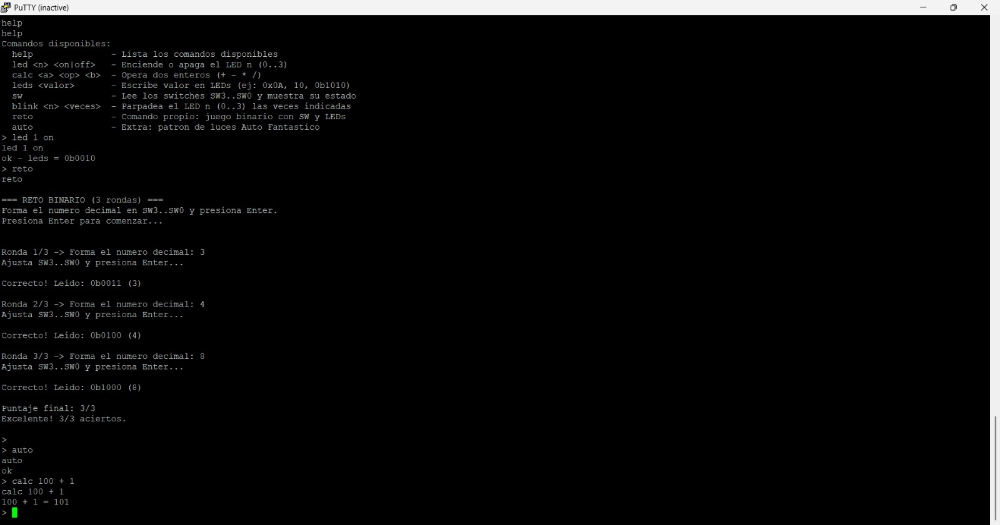

# Lab06 - Primer paso con PicoSoC y PicoRV32

## Integrantes

- Daniel Penagos Castro - [GitHub](https://github.com/Daniel-Penagos)
- Danilo Forero Rodriguez - [GitHub](https://github.com/jouseddaniloS)
- Brayan Extidt Torres Gaona - [GitHub](https://github.com/BrayanExtidt)

---

## Índice

1. [Introducción](#1-introducción)
2. [Objetivos](#2-objetivos)
3. [Marco teórico](#3-marco-teórico)
4. [Arquitectura del sistema](#4-arquitectura-del-sistema)
5. [Herramientas utilizadas](#5-herramientas-utilizadas)
6. [Desarrollo del laboratorio](#6-desarrollo-del-laboratorio)
7. [Comandos implementados](#7-comandos-implementados)
8. [Verificación y pruebas](#8-verificación-y-pruebas)
9. [Implementación en FPGA](#9-implementación-en-fpga)
10. [Preguntas](#10-preguntas)
11. [Conclusiones](#11-conclusiones)
12. [Referencias](#12-referencias)

---

## 1. Introducción

En este laboratorio se realiza una primera aproximación al diseño e implementación de un sistema basado en un **System on Chip (SoC)** utilizando el procesador PicoRV32, una arquitectura basada en el conjunto de instrucciones RISC-V.

El sistema integra diferentes componentes, como memoria ROM, memoria RAM, UART y periféricos GPIO, permitiendo ejecutar programas desarrollados en lenguaje C y establecer comunicación con un computador externo.

La implementación se realiza sobre una FPGA **Altera Cyclone IV**, utilizando las herramientas de desarrollo de Intel Quartus Prime.

## 2. Objetivos

### Objetivo general

Comprender el funcionamiento de un sistema SoC basado en el procesador PicoRV32 y realizar su implementación en una FPGA Altera Cyclone IV.

### Objetivos específicos

- Identificar los componentes principales de un sistema SoC.
- Comprender el funcionamiento del procesador PicoRV32 y su arquitectura RISC-V.
- Configurar las herramientas necesarias para compilar programas destinados a RISC-V.
- Desarrollar y ejecutar firmware en lenguaje C.
- Comprender la comunicación entre el procesador y los periféricos mediante UART y GPIO.
- Implementar y verificar el funcionamiento del sistema en la FPGA.

## 3. Marco teórico

### 3.1. System on Chip (SoC)

Un System on Chip es un sistema que integra diferentes componentes electrónicos dentro de un mismo circuito integrado. Entre estos componentes se encuentran el procesador, las memorias y los periféricos de entrada y salida.

Su objetivo es reunir los elementos necesarios para ejecutar un sistema de manera integrada, reduciendo la necesidad de utilizar múltiples circuitos independientes.

### 3.2. Arquitectura RISC-V

RISC-V es una arquitectura de conjunto de instrucciones (ISA) de tipo RISC, caracterizada por utilizar instrucciones simples y una estructura abierta.

Esta arquitectura permite desarrollar procesadores para diferentes aplicaciones, desde sistemas embebidos hasta sistemas de procesamiento más complejos.

### 3.3. Procesador PicoRV32

PicoRV32 es un núcleo de procesador de 32 bits compatible con la arquitectura RISC-V, desarrollado por Clifford Wolf.

Se caracteriza por su reducido consumo de recursos de hardware, lo que permite utilizarlo en sistemas embebidos implementados en FPGA.

Su comunicación con las memorias y los periféricos utiliza señales como:

| Señal | Función |
|---|---|
| `mem_valid` | Indica que existe una solicitud de acceso a memoria. |
| `mem_ready` | Indica que la solicitud puede completarse. |
| `mem_addr` | Dirección de memoria que se desea acceder. |
| `mem_wdata` | Datos que se desean escribir. |
| `mem_rdata` | Datos recibidos durante una lectura. |
| `mem_wstrb` | Indica qué bytes se escriben. |

### 3.4. Firmware

El firmware es el conjunto de instrucciones que ejecuta el procesador para realizar las funciones del sistema.

En este laboratorio se desarrolla utilizando lenguaje C. Posteriormente, el código se compila para generar instrucciones compatibles con la arquitectura RISC-V.

### 3.5. Compilación cruzada

La compilación cruzada permite generar un programa para una arquitectura diferente a la del computador donde se desarrolla.

En este caso, el programa se desarrolla desde un computador con arquitectura x86-64, pero se compila para ejecutarse en el procesador RISC-V de 32 bits.

### 3.6. Comunicación UART

UART es un protocolo de comunicación serial asíncrona que permite transmitir y recibir información entre dispositivos sin utilizar una señal de reloj compartida.

En este laboratorio se utiliza para establecer comunicación entre el SoC y un computador, permitiendo enviar comandos y recibir respuestas mediante una terminal serial.

---

## 4. Arquitectura del sistema

El sistema está compuesto por los siguientes bloques principales:

- **PicoRV32:** procesador encargado de ejecutar las instrucciones del firmware.
- **ROM:** almacena el programa que ejecuta el procesador.
- **RAM:** permite almacenar temporalmente datos durante la ejecución.
- **UART:** permite la comunicación serial con el computador.
- **GPIO:** permite controlar las salidas LED y leer las entradas de los interruptores.
- **Interconexión interna:** permite la comunicación entre el procesador, las memorias y los periféricos.

### 4.1. Diagrama general de bloques

```text
                 +----------------------+
                 |       PicoRV32       |
                 |      Procesador      |
                 +----------+-----------+
                            |
                    Bus de memoria
                            |
          +-----------------+-----------------+
          |                 |                 |
     +----v----+       +----v----+       +----v----+
     |   ROM   |       |   RAM   |       | Periféricos|
     +---------+       +---------+       +-----+----+
                                                |
                              +-----------------+----------------+
                              |                 |                |
                         +----v----+       +----v----+      +----v----+
                         |  UART   |       |  LEDs   |      | Switches|
                         +---------+       +---------+      +---------+
                              |
                         Computador
```

### 4.2. Mapa de memoria de periféricos

Los periféricos se controlan mediante direcciones de memoria asignadas dentro del sistema. Esto permite que el procesador interactúe con ellos utilizando operaciones de lectura y escritura.

| Registro | Función |
|---|---|
| `REG_UART_DATA` | Permite transmitir y recibir datos mediante UART. |
| `REG_LEDS` | Permite controlar los LED de salida. |
| `REG_SWITCHES` | Permite leer el estado de los interruptores. |

Las direcciones exactas deben corresponder a las definiciones utilizadas en el firmware y a la implementación Verilog del SoC.

---

## 5. Herramientas utilizadas

| Herramienta | Función |
|---|---|
| Intel Quartus Prime | Síntesis, compilación e implementación del diseño en FPGA. |
| MSYS2 | Entorno para ejecutar comandos y herramientas de compilación. |
| GCC RISC-V | Compilador cruzado para generar firmware compatible con RISC-V. |
| Make | Automatización del proceso de compilación. |
| Git | Control de versiones y descarga del repositorio. |
| PuTTY | Comunicación serial con el sistema mediante UART. |
| FPGA Altera Cyclone IV | Dispositivo utilizado para implementar el sistema. |

---

## 6. Desarrollo del laboratorio

### 6.1. Preparación del entorno

Se utiliza MSYS2 para disponer de un entorno de terminal que permite ejecutar las herramientas necesarias para compilar el firmware y trabajar con el proyecto.

Se actualizan los paquetes:

```bash
pacman -Syu
```

Posteriormente, se instalan las herramientas necesarias:

```bash
pacman -S make gcc git mingw-w64-x86_64-toolchain
```

### 6.2. Configuración del compilador RISC-V

Se configura la variable PATH para permitir que el sistema encuentre las herramientas del compilador.

Ejemplo:

```bash
export PATH="/c/tools/riscv/bin:$PATH"
```

Para comprobar la instalación:

```bash
riscv-none-elf-gcc --version
```

### 6.3. Descarga del repositorio

Se descarga el proyecto del laboratorio mediante Git:

```bash
git clone https://github.com/digital-ECCI/picoSoC_simple.git
```

Después se ingresa al directorio:

```bash
cd picoSoC_simple
```

### 6.4. Configuración de Quartus

Se agrega la ruta de instalación de Quartus al PATH:

```bash
export PATH=/c/intelFPGA_lite/23.1std/quartus/bin:$PATH
```

Esta configuración permite ejecutar las herramientas de Quartus desde la terminal.

### 6.5. Compilación del firmware

Para generar el programa binario y el archivo de inicialización de memoria se ejecuta:

```bash
make
```

Este proceso genera archivos como:

- `main.bin`: archivo binario del firmware.
- `progmem.v`: archivo Verilog que contiene la información del programa para su almacenamiento en memoria.

### 6.6. Compilación del hardware

Se utiliza Quartus para realizar la síntesis, el ajuste y la generación del archivo de configuración de la FPGA.

El objetivo de compilación debe corresponder a la configuración de la FPGA Altera Cyclone IV definida en el proyecto y en el Makefile.

```bash
make build TARGET=<objetivo_configurado_en_el_Makefile>
```

El proceso comprende las siguientes etapas:

- **Map:** asignación de recursos lógicos.
- **Fit:** ajuste del diseño a los recursos físicos de la FPGA.
- **Asm:** generación del archivo de configuración de la FPGA.

### 6.7. Visualización del diseño RTL

Para abrir el proyecto en Quartus se utiliza:

```bash
quartus --64bit top.qpf
```

Posteriormente, desde el entorno gráfico se accede a:

`Tools > Netlist Viewers > RTL Viewer`

Esta herramienta permite observar la estructura lógica del circuito sintetizado y las conexiones entre los diferentes módulos del sistema.

### 6.8. Programación de la FPGA

Una vez generado el archivo de configuración, se programa la FPGA Altera Cyclone IV mediante el procedimiento de programación correspondiente al proyecto.

El objetivo utilizado en el comando debe coincidir con el configurado en el Makefile:

```bash
make program TARGET=<objetivo_configurado_en_el_Makefile>
```

---

## 7. Comandos implementados

El firmware desarrollado en `main.c` permite interactuar con el sistema mediante una consola serial UART.

El usuario envía comandos desde el computador y el procesador interpreta las instrucciones para controlar los periféricos o realizar operaciones.

### 7.1. Comando `help`

Muestra los comandos disponibles en la consola.

```text
> help
```

### 7.2. Comando `led`

Permite encender o apagar un LED específico.

```text
> led 3 on
ok
```

### 7.3. Comando `calc`

Permite realizar operaciones aritméticas básicas entre dos números.

Operaciones disponibles:

- Suma (`+`).
- Resta (`-`).
- Multiplicación (`*`).
- División (`/`).

Ejemplo:

```text
> calc 6 * 7
6 * 7 = 42
```

### 7.4. Comando `leds`

Permite controlar los LED mediante un valor numérico.

Ejemplo:

```text
> leds <valor>
```

El valor ingresado determina el estado de las salidas LED según la implementación del firmware.

### 7.5. Comando `sw`

Permite consultar el estado de los interruptores de entrada.

Ejemplo:

```text
> sw
switches = 0b0101
```

### 7.6. Comando `blink`

Permite hacer parpadear un LED una cantidad determinada de veces mediante retardos implementados por software.

Ejemplo:

```text
> blink <n> <veces>
```

### 7.7. Comando personalizado

Se implementa un comando adicional como parte de la actividad del laboratorio.

**Nombre del comando:** [Agregar nombre del comando].

**Descripción:** [Explicar su funcionamiento].

**Ejemplo de ejecución:**

```text
> [Agregar comando]
[Agregar respuesta]
```

---

## 8. Verificación y pruebas

Para comprobar el funcionamiento del sistema se realizan pruebas mediante la consola serial y los periféricos físicos de la FPGA.

| Prueba | Resultado esperado |
|---|---|
| Ejecutar `help` | Mostrar los comandos disponibles. |
| Ejecutar `led` | Encender o apagar el LED indicado. |
| Ejecutar `calc` | Mostrar el resultado de la operación. |
| Ejecutar `leds` | Modificar el estado de los LED. |
| Ejecutar `sw` | Mostrar el estado de los interruptores. |
| Ejecutar `blink` | Hacer parpadear el LED seleccionado. |
| Ejecutar el comando personalizado | Realizar la función programada. |

Los resultados obtenidos deben documentarse con evidencias de la ejecución real del sistema.

---

## 9. Implementación en FPGA

La implementación física del sistema se realiza sobre una FPGA **Altera Cyclone IV**.

Una vez compilado el diseño y generado el archivo de configuración, se programa el dispositivo para ejecutar el SoC.

La verificación se realiza mediante la comunicación serial con el computador utilizando PuTTY. Desde esta terminal se envían los comandos implementados en el firmware y se comprueba la respuesta del sistema.

También se verifica el comportamiento de los LED y los interruptores físicos de la FPGA.
<br>
*Figura 1: Concola de comandos con algunas instrucciones.


### 9.1. Evidencias de implementación

En esta sección se deben incluir:

- Fotografías de la FPGA Altera Cyclone IV.
- Capturas de la consola serial PuTTY.
- Evidencias del control de los LED.
- Evidencias de lectura de los interruptores.
- Video de funcionamiento del laboratorio.

**Video de implementación:**

[Ver video de implementación del Laboratorio 06 en YouTube](https://youtu.be/ij-zRW-T4-Y)

---

## 10. Preguntas

### 1. ¿Qué es un mapa de memoria?

Es una organización de direcciones que permite identificar las memorias y los periféricos disponibles dentro del sistema. Cada dirección permite acceder a un recurso específico.

### 2. ¿Cómo se utilizan `REG_LEDS`, `REG_SW` y `REG_UART_DAT`?

Son registros asociados a periféricos del SoC. Permiten controlar las salidas LED, leer los interruptores y realizar operaciones de comunicación UART, respectivamente.

### 3. ¿Qué significa `volatile` y por qué se utiliza?

Es un modificador de C que indica al compilador que el valor de una variable puede cambiar por causas externas al flujo normal del programa. Se utiliza especialmente al acceder a registros de hardware para evitar optimizaciones que puedan alterar el comportamiento esperado.

### 4. ¿Qué es UART y para qué sirve?

UART es un protocolo de comunicación serial asíncrona que permite transmitir y recibir información entre dispositivos utilizando líneas de transmisión y recepción.

### 5. ¿Qué diferencia existe entre `argc` y `argv`?

`argc` representa la cantidad de argumentos recibidos por una función, mientras que `argv` es un arreglo que contiene los argumentos en forma de cadenas de caracteres.

### 6. ¿Qué hace `tokenize()`?

Divide una cadena de texto en diferentes partes o tokens, utilizando separadores definidos. Esto facilita la interpretación de los comandos enviados por la terminal.

### 7. ¿Cómo funcionan `parse_int()` y `parse_uint_auto()`?

Son funciones utilizadas para convertir cadenas de caracteres en valores numéricos. `parse_int()` permite interpretar números enteros con signo, mientras que `parse_uint_auto()` permite interpretar valores enteros sin signo utilizando el formato numérico correspondiente.

### 8. ¿Qué función cumple el procesador PicoRV32?

Es el núcleo encargado de ejecutar las instrucciones del firmware y controlar las operaciones del sistema mediante la comunicación con las memorias y los periféricos.

### 9. ¿Qué es la compilación cruzada?

Es el proceso de generar un programa ejecutable para una arquitectura diferente a la del computador utilizado para desarrollarlo. En este laboratorio se compila código desde un computador convencional para ejecutarlo en un procesador RISC-V.

### 10. ¿Por qué se utiliza una FPGA?

Una FPGA permite implementar circuitos digitales mediante la configuración de sus recursos lógicos internos. En este laboratorio se utiliza para implementar físicamente el sistema SoC basado en PicoRV32.

---

## 11. Conclusiones

- Se comprendió la estructura general de un sistema SoC y la función de sus componentes principales.
- Se estudió el funcionamiento del procesador PicoRV32 y su relación con la arquitectura RISC-V.
- Se identificó la importancia de la compilación cruzada para desarrollar firmware destinado a una arquitectura diferente a la del computador.
- Se comprendió cómo el procesador puede interactuar con periféricos mediante registros mapeados en memoria.
- Se trabajó con comunicación UART para enviar comandos y recibir información desde una terminal serial.
- Se realizó la implementación del sistema en una FPGA Altera Cyclone IV, integrando hardware y firmware.

## 12. Referencias

- [PicoRV32 - GitHub](https://github.com/YosysHQ/picorv32)
- [PicoSoC Simple - ECCI](https://github.com/digital-ECCI/picoSoC_simple.git)
- [RISC-V International](https://riscv.org/)
- [Intel Quartus Prime](https://www.intel.com/content/www/us/en/software/programmable/quartus-prime/overview.html)
